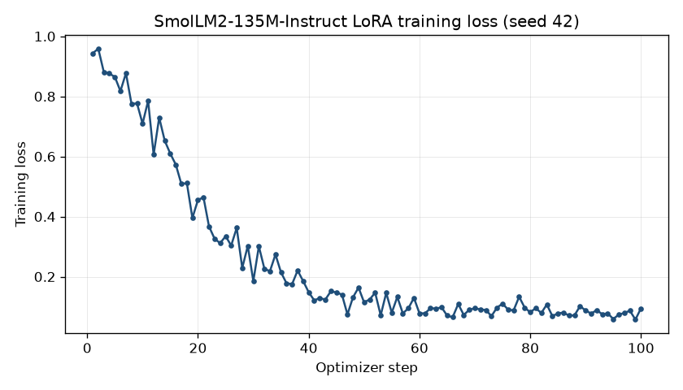

# LoRA supervised fine-tuning for support-ticket slot filling

A small, CPU-reproducible supervised fine-tune of [HuggingFaceTB/SmolLM2-135M-Instruct](https://huggingface.co/HuggingFaceTB/SmolLM2-135M-Instruct) with [TRL](https://github.com/huggingface/trl) and [PEFT](https://github.com/huggingface/peft). The task is narrow on purpose: the model reads a short customer message and emits one JSON object, and every prediction is scored automatically.

The numbers in the results section come from one measured run on this repository's committed prediction files. They are written by `ticket_sft.report` from those files. This repository does not contain a Halo training run, a Modal GPU run, or a preference-tuning run. Those are described as next steps because they were not executed.

Jordi Garriga Serés, Computer Engineering student at UOC. GitHub: [XnOwOCodes](https://github.com/XnOwOCodes). The project is a public record of a real LoRA fine-tune that can be linked from an application to White Circle's [Halo](https://github.com/whitecircle/halo) post-training competition.

## Results

<!-- RESULTS:START -->
These figures are computed from `results/*.json` and the prediction jsonl files.
They are not typed in by hand. Exact match is semantic: recovered JSON must be
schema-valid and every field must match the gold label.

Hardware: Intel(R) Xeon(R) Processor, 4 CPUs, Python 3.12.3, torch 2.15.0+cpu. CUDA available: false. Seed 42.

Model: `HuggingFaceTB/SmolLM2-135M-Instruct`. Train rows: 200. Eval rows: iid 40, ood 40. LoRA r=8, alpha=16, dropout=0.05, targets `q_proj, k_proj, v_proj, o_proj`. Trainable parameters: 921,600 / 135,436,608 (0.68%). Supervised tokens: 15.1% of training tokens. Max sequence length seen: 212 (limit 512, truncated 0).

Training loop wall time: 202.5s. Trainer-reported train_runtime: 202.4s. Optimizer steps: 100. Final logged training loss: 0.0945. Minimum logged training loss: 0.0572. Baseline eval wall time: 112.5s. Post-training eval wall time: 59.4s.

Generation is greedy (`do_sample=false`, `max_new_tokens=64`). One item on either 40-row eval split is 2.5 percentage points. The keyword heuristic is not a neural model. It always emits canonical JSON, so its strict-JSON rate is 1 by construction.

In-distribution exact match is higher after LoRA (0/40 to 17/40). Paraphrase exact match is higher after LoRA (0/40 to 2/40).

| Split | System | Strict JSON | Canonical JSON | Schema valid | Exact match | Field accuracy | Intent | Order id | Amount | Priority |
| --- | --- | --- | --- | --- | --- | --- | --- | --- | --- | --- |
| iid | base SmolLM2-135M-Instruct | 1/40 (2.5%) | 0/40 (0.0%) | 0/40 (0.0%) | 0/40 (0.0%) | 2/160 (1.2%) | 1/40 (2.5%) | 0/40 (0.0%) | 0/40 (0.0%) | 1/40 (2.5%) |
| iid | SmolLM2-135M-Instruct + LoRA | 40/40 (100.0%) | 17/40 (42.5%) | 25/40 (62.5%) | 17/40 (42.5%) | 126/160 (78.8%) | 34/40 (85.0%) | 24/40 (60.0%) | 39/40 (97.5%) | 29/40 (72.5%) |
| iid | keyword heuristic (train cues) | 40/40 (100.0%) | 40/40 (100.0%) | 40/40 (100.0%) | 40/40 (100.0%) | 160/160 (100.0%) | 40/40 (100.0%) | 40/40 (100.0%) | 40/40 (100.0%) | 40/40 (100.0%) |
| ood | base SmolLM2-135M-Instruct | 1/40 (2.5%) | 0/40 (0.0%) | 0/40 (0.0%) | 0/40 (0.0%) | 8/160 (5.0%) | 1/40 (2.5%) | 0/40 (0.0%) | 2/40 (5.0%) | 5/40 (12.5%) |
| ood | SmolLM2-135M-Instruct + LoRA | 40/40 (100.0%) | 2/40 (5.0%) | 14/40 (35.0%) | 2/40 (5.0%) | 98/160 (61.2%) | 18/40 (45.0%) | 18/40 (45.0%) | 39/40 (97.5%) | 23/40 (57.5%) |
| ood | keyword heuristic (train cues) | 40/40 (100.0%) | 4/40 (10.0%) | 40/40 (100.0%) | 4/40 (10.0%) | 108/160 (67.5%) | 8/40 (20.0%) | 40/40 (100.0%) | 40/40 (100.0%) | 20/40 (50.0%) |

Training loss is token cross-entropy on the supervised completion, not the exact-match score.
Each plotted point is one logged optimizer step. The curve is not smoothed.
Loss curve file: `results/loss_curve.png`.

Data sha256: train `64b198e4c60a2907dacd0521dc7700ab02033890aa0788ff73632ec58b16b840`, iid `0abd5beb9d9b1b78bd06fa802786445f9748a73d6d59cf75718835a3871f2352`, ood `b6bb3b7ce842b96faf65d48b32d5c43112553c9227455c144bd8864c7f9b2ab6`.
System prompt sha256 `00726ec182db0c0c33cb773d0e0458ed815bca1a8d952704850bd43f7a3fbd1f`.

In-distribution example (`iid-0000`), first row in the predictions file, not selected by hand:

Gold: `{"intent":"billing","order_id":"ORD-30012","amount_usd":45,"priority":"medium"}`

Base model output:

```
The customer message indicates that they were charged $45 on the order ID 30012, which is the order number. The order ID is 30012, and the customer message states that they were charged $45.
```

Base fields correct: intent=no, order_id=no, amount_usd=no, priority=no.

LoRA output:

```
{"intent":"billing","order_id":"ORD-30012","amount_usd":45,"priority":"medium"}
```

LoRA fields correct: intent=yes, order_id=yes, amount_usd=yes, priority=yes.

Paraphrase example (`ood-0000`), first row in the predictions file, not selected by hand:

Gold: `{"intent":"other","order_id":null,"amount_usd":null,"priority":"medium"}`

Base model output:

```
Here is a JSON object that represents the customer message:

'''json
{
  "intent": "refund",
  "order_id": "1234567890",
  "amount_usd": 1000,
  "priority": "high",
```

Base fields correct: intent=no, order_id=no, amount_usd=no, priority=no.

LoRA output:

```
{"intent":"other","order_id":"634","amount_usd":null,"priority":"medium"}
```

LoRA fields correct: intent=yes, order_id=no, amount_usd=yes, priority=yes.
<!-- RESULTS:END -->



## Why this task

SmolLM2-135M-Instruct is small enough to fine-tune on a CPU, and its model card reports GSM8K (5-shot) at 1.4%. This repository does not re-measure GSM8K. Chain-of-thought math answers are also long, so a full GSM8K eval would spend most of the CPU time generating text rather than showing whether supervised fine-tuning changed a scorable behavior.

Slot filling has a short target and an automatic metric:

- `strict_json`: the stripped generation is itself a JSON object.
- `canonical_exact`: the stripped generation equals the training target byte for byte.
- `schema_valid`: the recovered object has exactly the four keys and legal value types.
- `exact_match`: the object is schema-valid and every field matches the gold label. This is the headline metric. It is semantic, so whitespace and `12` versus `12.0` still count.
- `field_accuracy`: correct fields divided by `4 * n`, plus the same rate per field.

Gold labels are produced by a deterministic generator, not by human annotators. A keyword heuristic that uses only the training-frame phrases is reported beside the model so that gap is visible. Order ids and dollar amounts are regular expressions on every split. Intent and priority cues in the paraphrase split do not appear in the training frames, except for the default classes (`other`, `medium`).

## Method

### Data

`ticket_sft.data` builds three JSONL files with seed 42:

| Split | Rows | What it is |
| --- | ---: | --- |
| `data/train.jsonl` | 200 | 40 sentence frames, 5 draws each |
| `data/eval_iid.jsonl` | 40 | the same frames, new order ids, amounts, and case numbers |
| `data/eval_ood.jsonl` | 40 | 20 paraphrase frames, 2 draws each |

Each message ends with a unique `Case N.` suffix so repeated frames are not identical strings. Order-id ranges do not overlap: train `ORD-10000` and up, in-distribution `ORD-30000` and up, paraphrase `ORD-60000` and up. The generator checks that the training-cue heuristic matches every train and in-distribution label, and that it does not solve paraphrase intent or non-default priority from those cues. `tests/test_data_and_metrics.py` fails if the committed JSONL drifts from the generator. `data/manifest.json` stores the SHA-256 of each file.

The prompt asks for `intent`, `order_id`, `amount_usd`, and `priority`. Intent is one of `refund`, `shipping`, `billing`, `account`, `other`. Priority is `high`, `medium`, or `low`. Missing slots are JSON `null`. The training target is compact JSON from `ticket_sft.schema.canonical_json`. Only the customer message is shown to the model. Frame ids are not in the prompt.

### Model and LoRA

| Choice | Value |
| --- | --- |
| Base model | `HuggingFaceTB/SmolLM2-135M-Instruct` |
| Method | supervised fine-tuning, completion tokens only |
| LoRA | r=8, alpha=16, dropout=0.05, bias none |
| Target modules | `q_proj`, `k_proj`, `v_proj`, `o_proj` |
| Optimizer | AdamW, learning rate 2e-4, cosine schedule, warmup ratio 0.05, weight decay 0.01 |
| Batch | 1, gradient accumulation 4, 2 epochs, seed 42 |
| Precision | float32 on CPU |
| Max length | 512 tokens, and the run aborts if any example would be truncated |
| Decoding | greedy, `max_new_tokens=64` |

The base weights stay frozen. The adapter is saved under `artifacts/adapter` and is gitignored. Loss in the plot is the training loss of the supervised tokens, not the exact-match score.

### What is compared

1. Keyword heuristic on the two held-out files.
2. Base SmolLM2-135M-Instruct, same prompt, greedy decoding.
3. The same model with the trained LoRA adapter, same decoding.

Train labels are not used as an eval set. The training script reads `data/train.jsonl` only.

## Reproduce

The published run used CPython 3.12 on a 4-core CPU with no GPU. Package versions are pinned in `requirements.txt`, including the CPU wheel of PyTorch.

```bash
python3 -m venv .venv
source .venv/bin/activate
pip install -r requirements.txt
export PYTHONHASHSEED=42
export OMP_NUM_THREADS=4
export MKL_NUM_THREADS=4
export TOKENIZERS_PARALLELISM=false
python -m unittest tests.test_data_and_metrics -v
python -m ticket_sft.run_experiment
```

`run_experiment` regenerates the JSONL, reruns the unit tests, scores the heuristic, evaluates the base model, trains, evaluates the adapter, writes `results/loss_curve.png` and the results table, and runs `ticket_sft.check_results`. That check recomputes every count from the prediction files and exits non-zero if the README table disagrees.

Individual steps:

```bash
python -m ticket_sft.data
python -m ticket_sft.baselines
python -m ticket_sft.evaluate --which base
python -m ticket_sft.train
python -m ticket_sft.evaluate --which adapter
python -m ticket_sft.plot_loss
python -m ticket_sft.report
python -m ticket_sft.check_results
```

The first model load downloads SmolLM2-135M-Instruct from Hugging Face (about 270MB of weights). Wall times from the published run are in the results section. `results/logs/experiment.log` is the stdout of that run, and `results/train_summary.json` stores every logged training loss. Another machine will not match those times to the second. Greedy decoding removes sampling noise, but CPU kernels and library versions can still change a token. The committed prediction files are the record of the run that was actually executed.

## Repository layout

```text
ticket_sft/          data generator, trainer, evaluator, report, results check
tests/               generator and scorer tests; no model weights required
data/                committed train and eval JSONL plus manifest
results/             metrics, predictions, logs, loss curve, results table
modal_train.py       same recipe on Qwen3-4B via Modal; not run
artifacts/           adapter output; gitignored
```

## Limitations

- The labels are synthetic. A generator assigns them from the sentence frame and the slots it inserts. This is a closed task, not an open-domain extraction benchmark.
- The in-distribution split reuses the training sentence frames. A gain there mostly shows that the model learned those frames and the JSON format, not that it learned new wording.
- The paraphrase split is 40 rows. One row is 2.5 percentage points.
- The keyword heuristic is a reference, not a model, and it is perfect on the training frames by construction.
- 135M parameters and a few hundred CPU updates are not evidence about Qwen3-4B, GSM8K, or a multi-GPU trainer.
- One seed, greedy decoding, no validation-based checkpoint selection.
- Training loss can fall while exact match does not, and the report states both.

## Next steps

### Modal, not run

`modal_train.py` is the same data, prompt, seed, LoRA rank, learning rate, and epoch count on `Qwen/Qwen3-4B-Instruct-2507`, in bfloat16 on a Modal A100, with gradient checkpointing enabled so the 4B model fits. It was not launched. Running it spends money. The guard and the command are at the top of that file. No Hugging Face token was available here, so the SmolLM2 adapter was not uploaded either. After a local training run:

```bash
huggingface-cli login
huggingface-cli upload <user>/smollm2-135m-ticket-lora artifacts/adapter
```

### Halo, not run

[Halo](https://github.com/whitecircle/halo) trains Hugging Face models with its own trainers for SFT, preference optimization, and asynchronous GRPO. The published images are GPU images, not a CPU stack: `public.ecr.aws/whitecircle/halo:hopper` for H100/H200 and `public.ecr.aws/whitecircle/halo:blackwell` for B200/B300. A reasonable first Halo job is their LoRA example [`examples/sft/qwen3/qwen3-4b-ultrachat-lora.yaml`](https://github.com/whitecircle/halo/blob/main/examples/sft/qwen3/qwen3-4b-ultrachat-lora.yaml), pointed at this JSONL instead of UltraChat, then:

```bash
halo launch sft path/to/ticket-lora.yaml
```

That command was not run. Halo is the path from this single-process LoRA run to multi-GPU SFT and, after that, to preference and RL training in the same codebase.

### Preference optimization and GRPO, not run

The scorer in `ticket_sft.metrics` is a verifiable reward: schema validity and field match do not need a judge model. Two follow-ups are natural once a larger SFT model exists. DPO (or Halo's preference trainer) can use pairs where the chosen completion is the gold JSON and the rejected completion is a real sample that failed the scorer. GRPO, including Halo's online and environment rollouts, can use exact match as the reward directly. Neither dataset of preferences nor any RL run exists in this repository.

## License

Apache License 2.0. See [LICENSE](LICENSE). SmolLM2-135M-Instruct is also Apache-2.0; see its model card. The Qwen3-4B model card applies if `modal_train.py` is run.
